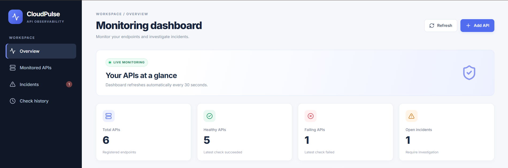
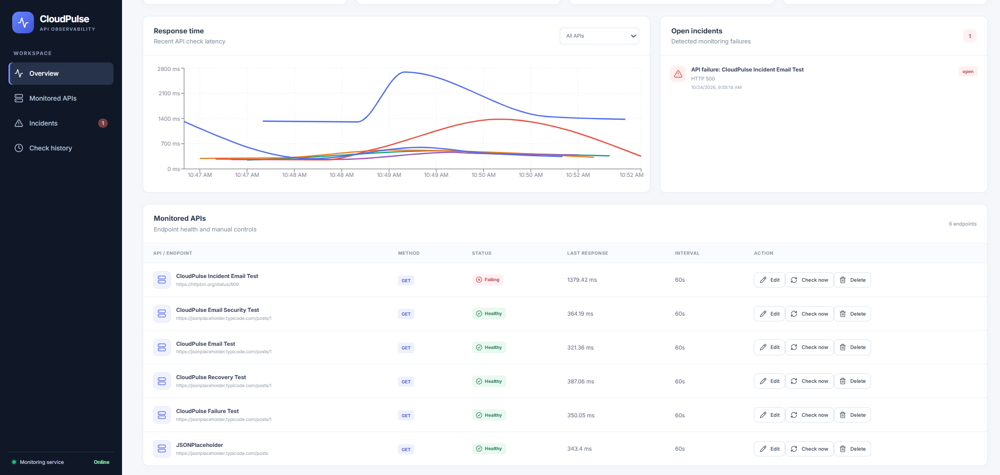

# CloudPulse — API Monitoring and Incident Management Platform


CloudPulse is a full-stack API monitoring platform that periodically checks registered endpoints, records HTTP status codes and response times, detects failures, manages incidents, and sends email notifications.

The project combines a React frontend, FastAPI backend, PostgreSQL database, Redis message broker, and Celery background workers to demonstrate API monitoring and incident management.


## Dashboard Preview

### Monitoring Overview



CloudPulse dashboard showing monitored API counts, healthy and failing endpoints, and open incidents.

### Response Times and Monitored APIs



View response-time trends, endpoint health, monitoring intervals, and endpoint management actions.


## Features

- **API Management:** Register and manage monitored API endpoints.
- **Automated Health Checks:** Schedule recurring HTTP checks for registered endpoints.
- **Performance Tracking:** Record HTTP status codes, response times, and monitoring history.
- **Incident Management:** Create incidents when endpoints fail and resolve them when services recover.
- **Email Notifications:** Send SMTP email alerts for incidents.
- **Monitoring Dashboard:** View API health, failures, incident status, and monitoring data.
- **Background Processing:** Use Celery workers and Redis to process monitoring tasks asynchronously.
- **Task Scheduling:** Use APScheduler to schedule periodic monitoring jobs.
- **Retry Handling:** Retry eligible failed background tasks.
- **REST API Documentation:** Explore backend endpoints through FastAPI Swagger UI.
- **Automated Testing:** Test API endpoints, monitoring behavior, incident handling, and scheduler logic.
- **Docker Support:** Run the application stack using Docker Compose.

## Tech Stack

| Component | Technologies |
|---|---|
| Frontend | React, Vite, JavaScript |
| UI and Charts | Tailwind CSS, Recharts, Lucide |
| Backend | Python, FastAPI |
| Database | PostgreSQL |
| ORM and Validation | SQLAlchemy, Pydantic |
| Database Migrations | Alembic |
| Background Tasks | Celery |
| Message Broker | Redis |
| HTTP Monitoring | HTTPX |
| Scheduling | APScheduler |
| Testing | pytest |
| Containerization | Docker, Docker Compose |
| Version Control | Git, GitHub |

## Architecture

```text
                    User
                      |
                      v
               React Dashboard
                      |
                      v
                FastAPI Backend
                 /          \
                v            v
          PostgreSQL       APScheduler
          - API records         |
          - Check history       v
          - Incidents       Redis Queue
                                 |
                                 v
                           Celery Worker
                                 |
                                 v
                         External API Checks
                                 |
                                 v
                       Save Results and Incidents
                                 |
                                 v
                         SMTP Email Alerts
```

## Prerequisites

Install the following tools:

- Python 3.13 or a compatible Python version
- Node.js 22 or a compatible version
- npm
- PostgreSQL
- Docker Desktop with Docker Compose
- Git

## Getting Started

### 1. Clone the repository

```bash
git clone https://github.com/Subbu3699/CloudPulse.git
cd CloudPulse
```

### 2. Configure environment variables

Create a local `backend/.env` file and configure the database connection, application secret key, Redis URL, and SMTP settings required by the application.

Use your own credentials and a strong, unique secret key. Never commit `.env` files, passwords, application secrets, or SMTP app passwords to GitHub.

Ensure the PostgreSQL database is available and the required database schema or migrations have been applied.

### 3. Run with Docker Compose

From the project root directory, validate the Compose configuration:

```powershell
docker compose config --quiet
```

Build and start the application:

```powershell
docker compose up -d --build
```

Check service status:

```powershell
docker compose ps
```

View service logs:

```powershell
docker compose logs --tail=100
```

Stop the services:

```powershell
docker compose down
```

**Note:** The Docker Compose configuration expects PostgreSQL to be accessible using the configured database connection. Check `backend/.env` and the Compose configuration if a service fails to start.

### 4. Access the application

Once the services are running, open:

- **Dashboard:** http://localhost:5173
- **FastAPI Swagger documentation:** http://127.0.0.1:8000/docs
- **Backend health endpoint:** http://127.0.0.1:8000/health

## Local Development

### Backend

Open a terminal and run:

```powershell
cd backend
python -m venv venv
.\venv\Scripts\Activate.ps1
pip install -r requirements.txt
python -m uvicorn app.main:app --reload
```

Make sure PostgreSQL and the required environment variables are configured.

### Frontend

Open another terminal:

```powershell
cd frontend
npm ci
npm run dev
```

Open the local development URL printed by Vite, usually http://localhost:5173.

For local background monitoring, ensure Redis and the Celery worker are configured and running as required by the application.

## Testing

Run the backend test suite from the `backend` directory:

```powershell
.\venv\Scripts\Activate.ps1
python -m pytest -v
```

**Verified development result: 21 tests passed.**

The test suite covers API endpoints, monitoring behavior, and scheduler logic, including incident creation and recovery scenarios.

## Project Structure

```text
CloudPulse/
├── backend/
│   ├── app/
│   │   ├── main.py
│   │   ├── models.py
│   │   ├── schemas.py
│   │   ├── database.py
│   │   ├── monitor.py
│   │   ├── scheduler.py
│   │   ├── tasks.py
│   │   ├── celery_app.py
│   │   ├── redis_client.py
│   │   └── notifications.py
│   ├── migrations/
│   ├── tests/
│   ├── Dockerfile
│   ├── requirements.txt
│   └── .dockerignore
├── frontend/
│   ├── src/
│   ├── Dockerfile
│   └── .dockerignore
├── compose.yaml
├── README.md
└── .gitignore
```

## Security

- Keep environment files and credentials out of version control.
- Use strong, unique database passwords and application secret keys.
- Configure SMTP credentials through environment variables.
- Run backend and worker containers as non-root users.
- Avoid exposing database or Redis ports publicly unless required.
- Review logs before sharing them to ensure they do not contain secrets.

## Project Status

The core monitoring workflow has been tested locally with Docker Compose. Development verification has included API health checks, HTTP failure detection, incident recovery, SMTP email delivery, and the automated backend test suite.

Additional production hardening, deployment configuration, CI/CD integration, and sustained-load testing may be required before production use.

## Future Improvements

- GitHub Actions CI/CD pipeline
- Production deployment and environment-specific configuration
- Enhanced uptime and response-time analytics
- Improved observability and structured logging
- More comprehensive task deduplication and retry policies
- Additional integration and load tests

## Author

**Subba Raju Thotakura**

GitHub: https://github.com/Subbu3699

## License

Choose and add an appropriate open-source license before distributing the project publicly.

---

*CloudPulse is a portfolio project demonstrating full-stack development, API monitoring, asynchronous task processing, and incident management.*
